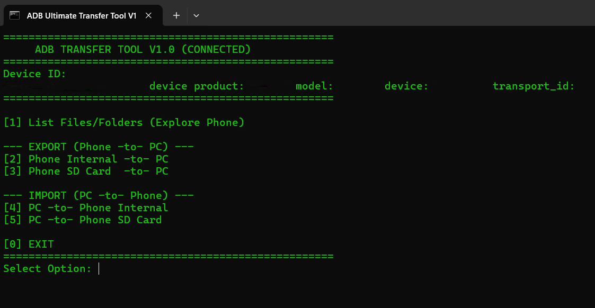

# ADB Ultimate Transfer Tool V1.0 🚀

A robust, batch-script wrapper for Android ADB (Android Debug Bridge). This tool allows for high-speed wired file transfers without the "freezing" or "estimating time" issues common with standard Windows MTP (File Explorer).

**Version:** 1.0
**Status:** Stable

## Why use this?
- **Speed:** It bypasses slow Windows file transfers (MTP) to talk directly to your phone, unlocking the maximum speed of your USB cable.
- **Stability:** Unlike regular Windows copying that freezes on folders with thousands of small files, this tool easily transfers massive WhatsApp backups or camera rolls without hanging.
- **Metadata:** It uses a special command flag (-a) to perfectly preserve your original photo and file creation dates instead of overwriting them with today's date.
- **Hidden Files** It ignores standard Windows restrictions, allowing you to access and copy hidden Android system files that are normally invisible.
- **Safety:** Built-in checks continuously monitor your USB connection so that if the cable disconnects, the transfer stops cleanly instead of silently leaving broken files on your PC.

## Features
- [x] **Auto-Detection:** Automatically checks for device connection and ADB authorization.
- [x] **Smart Menus:** Lists phone directories to help you find paths easily.
- [x] **Quote Handling:** Automatically strips quotes from PC paths (fixing "copy as path" errors).
- [x] **SD Card Support:** Dedicated modes for pulling from external storage.

## Prerequisites
1. **Unlock Developer Options:** Go to your phone's Settings > About Phone, and tap **Build Number** 7 times.
2. **Enable USB Debugging:** Navigate to Settings > System > Developer Options, and toggle on **USB Debugging**. *(Note: This is different from the standard USB connection popup).*
3. Download **SDK Platform Tools** from Google.

## Installation & Usage
1. Download `ADB-Transfer-Tool.bat` from this repository.
2. Place the file **inside** your platform-tools folder (the same folder where `adb.exe` is located).
3. Connect your phone via USB.
4. **CRITICAL:** Unlock your phone screen. A prompt will appear asking to **"Allow USB debugging?"**. Check "Always allow from this computer" and tap **Allow**.
5. Double click `ADB-Transfer-Tool.bat`.

> **Note on SD Cards:** Android 11+ restricts write access to the SD card via ADB. This tool allows you to READ (pull) from the SD card easily. If writing (pushing) to the SD card fails, push to Internal Storage first and move the file using a file manager on your phone.

## Troubleshooting
If the tool says **"NO ACTIVE DEVICE DETECTED"**:
1. Ensure your screen is unlocked and you have accepted the RSA fingerprint authorization prompt.
2. Verify that **USB Debugging** is toggled ON in Developer Options. 
3. Ensure your USB mode is **NOT** set to "File Transfer" (MTP can conflict with ADB). Set it to "Charging Only" or "No Data Transfer" from your phone's notification panel.

## License
MIT License
